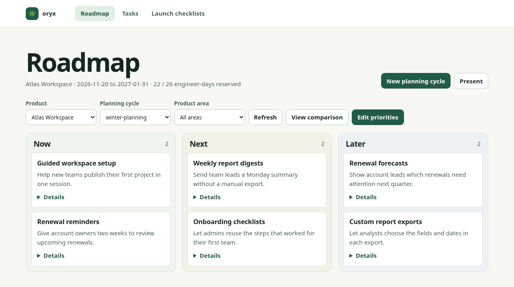

# oryx

**A personal workspace for PMs and founders who manage their own products with Codex or Claude Code.**

A customer asks for better reporting. You remember passing on it last quarter. What changed? With oryx, you can put today's interview beside the original decision and see whether the case is any stronger. Your evidence and decisions live in a private Git repository on your machine. Either client can pick up the thread next time.

I chose the oryx for its resilience and endurance in harsh environments. I’m building this to help PMs keep product craft alive as AI changes how we work. Knowing which question to ask, whose experience to trust, and when to change your mind still matters.

You own the product decisions and the words you share. Oryx can gather the evidence, work through trade-offs with you, and help write what you mean.
When time is tight, ask for expedite mode. Oryx takes on more legwork and keeps each evidence check and decision with its owner.

[Quick start](#quick-start) · [Make it yours](#make-it-yours) · [Browse the workflows](playbook/commands.md)

## What a day with oryx looks like

| When | What you might ask | What you get |
| --- | --- | --- |
| After an interview | “Here’s the interview. Capture why they export every Friday and what we still need to ask.” | A sourced meeting note that separates what the customer said from your interpretation. |
| Before roadmap review | “Reporting is back on the table. Compare these interviews with what we knew when we deferred it.” | The earlier rationale, the new evidence, and the assumptions you still need to test. |
| When capacity changes | “We can fit one of these two initiatives. Show me what we give up with each choice.” | A planning comparison you can discuss. You approve changes to the roadmap. |
| After launch | “We expected fewer support tickets. Compare the result with our forecast. What should we revisit?” | A review that keeps the original prediction alongside what happened. |

The local browser app lets you present the roadmap, review priorities, and work through launch checks. It shares records with the terminal. Review and confirm roadmap changes in either interface. [Browser guide](playbook/local-ui.md) · [Initiative approvals](playbook/initiative-approvals.md)

## Quick start

Install Git, Python 3.9 or later, and either Codex CLI or Claude Code. On Linux or WSL2, protected sessions need bubblewrap with working user namespaces. On macOS, they use `sandbox-exec`.

1. For the archive candidate, use the local CLI in [Install Core](playbook/installed-core.md). The steps below apply to source checkouts.
2. Clone this repository. Open a terminal in the checkout and start your preferred client.

   | Client | Run from Core |
   | --- | --- |
   | Codex CLI | `python3 tools/pm.py agent codex` |
   | Claude Code | `python3 tools/pm.py agent claude` |

3. **Step 0 — Set up your workspace.** Create a workspace or restore one from a private GitHub repository.
   Choose local storage or let Oryx connect GitHub. GitHub setup requires the GitHub CLI (`gh`).
   If you already have a local workspace, launch normally or add `--setup` to revisit GitHub setup.
4. Sign in to your client if prompted. Review and trust the Oryx project hooks.

Oryx asks before creating a GitHub repository or sending the first commit.
If an earlier run created the repository, choose **Connect** to resume.
For optional local conversation recording, see [session continuity](playbook/session-continuity.md).

Your first request starts the company walkthrough. You can share a source or explain the business in your own words.
Together you review customers, economics, the product portfolio, growth, and strategic trade-offs. You can leave questions open or say a topic does not apply.
If you’re a founder starting with an idea, your own account is enough to begin. Bring back what you learn and review what it changes.

Next, oryx asks about your role, day-to-day responsibilities, expectations and aspirations. You can review one point at a time or leave it open.
You can also map who you work with and how decisions happen. Oryx keeps the stakeholder map separate from your profile. [PM walkthrough](playbook/pm-context.md)

Step 3 covers the product as it works today. If you own a plugin, you still start with its parent product. Once you’ve reviewed the six topics, you can use the hub with questions open.

If you own part of that product, oryx offers an optional step 4 for your area. You can review it now, come back later, or skip it. Its findings go in a separate brief. [Product walkthrough](playbook/product-context.md)

After product or area setup, oryx offers to help you build a stakeholder profile. Start with one person, skip it, or return whenever it helps.
Ask “Where did we leave off?” to resume saved work in either client. [Work handoffs](playbook/handoffs.md)
You can enable [private session transcripts](playbook/session-continuity.md) and manage [context tips](playbook/context-advice.md) separately.

## Make it yours

“Going forward, start each weekly review with decisions you need from me.” Say it once and oryx saves the rule in your private workspace. The rule takes priority for that part of the review. You can also change a brief template, add a confidence column to your roadmap, or keep a different view for leadership. [Workflow rules](playbook/overrides.md) · [Templates, fields, and views](playbook/customization.md)

## Placement

**Core** ships software. Your selected Workspace has its own Git history. A source checkout defaults to `studio/`. Paths below start at their owner.

| Location | What lives there |
| --- | --- |
| `context/` | Company, PM, stakeholder and product context, sources, and meeting notes |
| `workspace/` | Discovery briefs, experiments, planning comparisons, and launch work |
| `customizations/` | Your standing rules, templates, fields, and views |
| `README.md` · `settings.json` | Your session handoff and local configuration |
| `playbook/` · `templates/` | Shared methods and starting points |
| Core `bin/` · `src/oryx/cli/` | Installed commands and action catalog routing |
| Core `src/oryx/workflows/` · `src/oryx/capabilities/` | PM workflow steps and the operations they call |
| Core `src/oryx/adapters/` · `src/oryx/workspace/` | Host and provider entry points, record identity and storage |
| Core `tools/` | Compatible entry points, browser assets and Workspace seeds |
| Core `.agents/` · `.claude/` · `.codex/` | Agent skills and client configuration |

In a source checkout, Step 0 can restore committed work from your private GitHub repository. [Filing guide](playbook/filing.md) · [Git and remotes](playbook/git.md) · [Updates and recovery](playbook/updates.md)

For a walkthrough from a customer signal to a roadmap decision, start with the [worked example](playbook/opportunities.md#worked-example). For the rules that guide both agents, read the [project constitution](AGENTS.md).

## License

oryx was created by Nathan D’Mello and was previously named PM Hub. See the [proprietary license](LICENSE.md).
